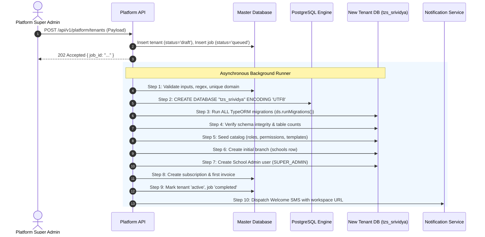

# Complete Multi-Tenant Architecture & Implementation Specification
## Tamilzorous School Management System (SaaS Edition)
### Modeled on `C:\Users\DELL\NOOL360\softsilk_api` with Zero-Drift TypeORM Migrations

---

## 1. Executive Summary & Core Principles

This specification defines the complete blueprint to transform the Tamilzorous School Management System into an enterprise-grade multi-tenant SaaS platform sold to multiple educational trusts, school groups, and private institutions.

### 1.1 Architecture Model
* **Master Database (`tamilzorous_platform`)**: Stores platform-wide metadata: registered tenants (school groups), subscription plans, billing cycles, GST tax invoices, payments, platform super-admin credentials, and automated provisioning jobs.
* **Tenant Database (`tzs_<subdomain>`)**: **One dedicated PostgreSQL database per customer/school group**. Contains all operational school data (students, staff, parents, classes, attendance, timetables, examinations, fees, buses, routes, boarding, diary, announcements, chat, app banners).
* **Multi-Branch Support**: A tenant is a School Group/Trust (e.g., "Sri Vidya Educational Trust"). Multiple campuses/branches operate inside that tenant's database as rows in the existing `schools` table (`school_id`). All existing row-level school isolation remains intact.
* **Telematics Decoupling**: **The Telematics service (`C:\Users\DELL\telematics-service`) is NOT multi-tenant.** It remains an independent telemetry engine on port 3001 tracking hardware devices (`device_id`). The School API maps `device_id` to the school's bus records via signed webhooks.

### 1.2 Comparison: `softsilk_api` vs. Our Enhanced Architecture

| Capability | `softsilk_api` (Reference) | Tamilzorous Enhanced SaaS |
|---|---|---|
| **Tenant DB Isolation** | Dedicated DB per tenant | Dedicated DB per tenant (`tzs_<subdomain>`) |
| **Schema Provisioning** | Raw SQL snapshot (`InitCoreTables...`) which drifts from migrations | **100% TypeORM Migrations execution** (`runMigrations()`) ensuring zero schema drift |
| **Connection Pooling** | Rebuilds connection on init; risk of connection leak | Managed pool (`TenantConnections`) caching Promises with LRU and idle eviction |
| **Request Scope** | Request-scoped durable providers (slow in NestJS, fails in Crons) | **`AsyncLocalStorage` context** + Proxy Repositories (zero service rewrites) |
| **Subdomain & URL** | Host-based resolution with manual port handling | **Environment-aware automatic URL generator** (localhost, dev, live, custom) |
| **Primary Keys** | UUIDs mixed with integers | Consistent **Integer Primary Keys** (`id`) across all entities |
| **Subscription Gate** | Blocks login on overdue; traps users | **Never blocks auth routes**; allows self-healing payments |

---

## 2. Dynamic Host, Subdomain & URL Resolution

URLs and protocols adapt dynamically according to the hosting environment without hardcoded strings in application code.

### 2.1 Environment Matrix

| Environment | Base Domain (`APP_BASE_DOMAIN`) | Port (`APP_WEB_PORT`) | Protocol | Example Tenant Workspace URL | Super Admin Control Plane |
|---|---|---|---|---|---|
| **Local Development** | `localhost` or `school.localhost` | `5173` | `http://` | `http://srividya.localhost:5173` | `http://admin.localhost:5173` |
| **Dev / Staging** | `dev.tamilzorous.com` | *(empty)* | `https://` | `https://srividya.dev.tamilzorous.com` | `https://admin.dev.tamilzorous.com` |
| **Live / Production** | `tamilzorous.com` | *(empty)* | `https://` | `https://srividya.tamilzorous.com` | `https://admin.tamilzorous.com` |
| **Custom Customer Domain** | *(tenant specific)* | *(empty)* | `https://` | `https://portal.srividya.edu.in` | *(N/A)* |

### 2.2 Protocol & Port Logic
1. If the base domain is `localhost` or ends with `.localhost`, protocol defaults to `http://`.
2. For all remote domains (dev, staging, production), protocol defaults to `https://`.
3. Port is only appended if explicitly specified in environment configuration (`APP_WEB_PORT=5173`).
4. Modern browsers (Chrome, Edge, Firefox) natively resolve `*.localhost` to `127.0.0.1` without any `/etc/hosts` modifications.

### 2.3 Shared URL Builder Function (Used in Backend & Email/SMS Dispatch)

```typescript
export interface AppEnvironmentConfig {
  base_domain: string; // e.g. "localhost", "dev.tamilzorous.com", "tamilzorous.com"
  web_port?: string;   // e.g. "5173" for local dev
  protocol_override?: 'http' | 'https';
}

export function buildWorkspaceUrl(subdomain: string, env: AppEnvironmentConfig): string {
  const base = env.base_domain.trim().toLowerCase();
  const isLocal = base === 'localhost' || base.endsWith('.localhost');
  const protocol = env.protocol_override ?? (isLocal ? 'http' : 'https');
  const portPart = env.web_port ? `:${env.web_port}` : '';

  return `${protocol}://${subdomain.toLowerCase()}.${base}${portPart}`;
}
```

---

## 3. Master Database Schema (`tamilzorous_platform`)

The Master DB has its own dedicated connection, migrations folder (`apps/school-api/src/database/platform-migrations`), and entities.

```
                              ┌─────────────────────────────────────────┐
                              │                 PLANS                   │
                              ├─────────────────────────────────────────┤
                              │ id, code, name, price_monthly, limits   │
                              └────────────────────┬────────────────────┘
                                                   │ 1:N
┌─────────────────────────────────┐   1:N          ▼          1:1       ┌─────────────────────────────────┐
│        PROVISIONING_JOBS        │◄───────  TENANTS  ───────────────►  │      TENANT_SUBSCRIPTIONS       │
├─────────────────────────────────┤          ├────────────────────────┤ ├─────────────────────────────────┤
│ id, status, steps, progress     │          │ id, code, database_name│ │ id, status, period_end, grace   │
└─────────────────────────────────┘          └───────────┬────────────┘ └────────────────┬────────────────┘
                                                         │ 1:N                           │ 1:N
                                                         ▼                               ▼
                                             ┌────────────────────────┐      ┌────────────────────────────┐
                                             │    PLATFORM_AUDIT      │      │      TENANT_INVOICES       │
                                             ├────────────────────────┤      ├────────────────────────────┤
                                             │ actor, action, diff    │      │ id, number, total, pdf_url │
                                             └────────────────────────┘      └────────────────────────────┘
```

### 3.1 Entity Definitions (TypeORM)

#### `tenants`
```sql
CREATE TABLE public.tenants (
  id SERIAL PRIMARY KEY,
  code VARCHAR(30) UNIQUE NOT NULL,               -- e.g. "srividya" (immutable, matches subdomain)
  name VARCHAR(150) NOT NULL,                     -- "Sri Vidya Educational Trust"
  legal_name VARCHAR(200),                        -- Registered entity name for Tax Invoices
  gstin VARCHAR(15),                              -- Indian GSTIN (e.g. 33ABCDE1234F1Z5)
  billing_address TEXT,
  billing_state_code VARCHAR(2) NOT NULL,         -- "33" for Tamil Nadu (drives CGST/SGST vs IGST)
  contact_name VARCHAR(100) NOT NULL,
  contact_mobile VARCHAR(15) NOT NULL,
  contact_email VARCHAR(150) NOT NULL,
  database_name VARCHAR(63) UNIQUE NOT NULL,      -- e.g. "tzs_srividya"
  status VARCHAR(20) NOT NULL DEFAULT 'draft',    -- draft | provisioning | active | suspended | failed | archived
  suspended_reason TEXT,
  logo_file_key VARCHAR(255),
  settings JSONB NOT NULL DEFAULT '{}'::jsonb,
  provisioned_at TIMESTAMPTZ,
  suspended_at TIMESTAMPTZ,
  created_at TIMESTAMPTZ NOT NULL DEFAULT now(),
  updated_at TIMESTAMPTZ NOT NULL DEFAULT now()
);
CREATE INDEX idx_tenants_code_active ON public.tenants(code) WHERE status = 'active';
```

#### `plans`
```sql
CREATE TABLE public.plans (
  id SERIAL PRIMARY KEY,
  code VARCHAR(30) UNIQUE NOT NULL,               -- "trial", "starter", "standard", "enterprise"
  name VARCHAR(100) NOT NULL,
  description TEXT,
  price_monthly NUMERIC(12,2) NOT NULL DEFAULT 0,
  price_yearly NUMERIC(12,2) NOT NULL DEFAULT 0,
  duration_days INT NOT NULL DEFAULT 30,          -- e.g. 30 for trial or monthly
  max_branches INT,                               -- null = unlimited
  max_students INT,
  max_staff INT,
  features JSONB NOT NULL DEFAULT '[]'::jsonb,    -- ["transport", "fees", "payroll", "chat", "exams"]
  is_trial BOOLEAN NOT NULL DEFAULT false,
  status VARCHAR(20) NOT NULL DEFAULT 'active',   -- active | retired
  sort_order INT NOT NULL DEFAULT 0,
  created_at TIMESTAMPTZ NOT NULL DEFAULT now(),
  updated_at TIMESTAMPTZ NOT NULL DEFAULT now()
);
```

#### `tenant_subscriptions`
```sql
CREATE TABLE public.tenant_subscriptions (
  id SERIAL PRIMARY KEY,
  tenant_id INT NOT NULL REFERENCES public.tenants(id) ON DELETE RESTRICT,
  plan_id INT NOT NULL REFERENCES public.plans(id) ON DELETE RESTRICT,
  billing_cycle VARCHAR(20) NOT NULL,             -- trial | monthly | yearly
  status VARCHAR(20) NOT NULL DEFAULT 'active',   -- trialing | active | past_due | suspended | cancelled
  payment_status VARCHAR(20) NOT NULL,            -- paid | unpaid
  current_period_start DATE NOT NULL,
  current_period_end DATE NOT NULL,
  trial_ends_on DATE,
  grace_ends_on DATE,
  locked_price NUMERIC(12,2) NOT NULL DEFAULT 0,
  discount_percent NUMERIC(5,2) NOT NULL DEFAULT 0,
  cancelled_at TIMESTAMPTZ,
  cancel_reason TEXT,
  created_at TIMESTAMPTZ NOT NULL DEFAULT now(),
  updated_at TIMESTAMPTZ NOT NULL DEFAULT now()
);
CREATE UNIQUE INDEX idx_single_active_sub ON public.tenant_subscriptions(tenant_id) 
WHERE status NOT IN ('cancelled', 'suspended');
```

#### `tenant_invoices`
```sql
CREATE TABLE public.tenant_invoices (
  id SERIAL PRIMARY KEY,
  tenant_id INT NOT NULL REFERENCES public.tenants(id) ON DELETE RESTRICT,
  subscription_id INT REFERENCES public.tenant_subscriptions(id) ON DELETE SET NULL,
  invoice_number VARCHAR(50) UNIQUE NOT NULL,     -- e.g. "TZ/INV/2026-27/00001"
  financial_year VARCHAR(10) NOT NULL,            -- "2026-27"
  issue_date DATE NOT NULL,
  due_date DATE NOT NULL,
  period_start DATE NOT NULL,
  period_end DATE NOT NULL,
  subtotal NUMERIC(12,2) NOT NULL,
  discount NUMERIC(12,2) NOT NULL DEFAULT 0,
  taxable NUMERIC(12,2) NOT NULL,
  cgst NUMERIC(12,2) NOT NULL DEFAULT 0,
  sgst NUMERIC(12,2) NOT NULL DEFAULT 0,
  igst NUMERIC(12,2) NOT NULL DEFAULT 0,
  total NUMERIC(12,2) NOT NULL,
  amount_paid NUMERIC(12,2) NOT NULL DEFAULT 0,
  status VARCHAR(20) NOT NULL DEFAULT 'unpaid',   -- draft | issued | paid | overdue | void
  pdf_file_key VARCHAR(255),
  seller_snapshot JSONB NOT NULL,                 -- Firm name, GST, Address at billing time
  buyer_snapshot JSONB NOT NULL,                  -- Tenant name, GST, Address at billing time
  created_at TIMESTAMPTZ NOT NULL DEFAULT now(),
  updated_at TIMESTAMPTZ NOT NULL DEFAULT now()
);
```

#### `provisioning_jobs`
```sql
CREATE TABLE public.provisioning_jobs (
  id UUID PRIMARY KEY DEFAULT gen_random_uuid(),
  tenant_id INT NOT NULL REFERENCES public.tenants(id) ON DELETE CASCADE,
  status VARCHAR(20) NOT NULL DEFAULT 'queued',   -- queued | running | completed | failed
  steps JSONB NOT NULL DEFAULT '[]'::jsonb,
  progress INT NOT NULL DEFAULT 0,
  error TEXT,
  payload JSONB NOT NULL,
  created_at TIMESTAMPTZ NOT NULL DEFAULT now(),
  updated_at TIMESTAMPTZ NOT NULL DEFAULT now()
);
```

#### `platform_admins`
```sql
CREATE TABLE public.platform_admins (
  id SERIAL PRIMARY KEY,
  name VARCHAR(100) NOT NULL,
  mobile VARCHAR(15) UNIQUE NOT NULL,
  email VARCHAR(150) UNIQUE NOT NULL,
  role VARCHAR(20) NOT NULL DEFAULT 'owner',      -- owner | sales | support | accounts
  is_active BOOLEAN NOT NULL DEFAULT true,
  created_at TIMESTAMPTZ NOT NULL DEFAULT now(),
  updated_at TIMESTAMPTZ NOT NULL DEFAULT now()
);
```

---

## 4. Automated Tenant Provisioning Engine

When a new tenant is created via the Super Admin Control Plane, the backend provisions the tenant database completely automatically. **No manual SQL scripts, no manual table creation.**

### 4.1 Ten-Step Automated Provisioning Pipeline



### 4.2 Provisioning Runner Implementation

```typescript
import { Injectable, Logger } from '@nestjs/common';
import { DataSource } from 'typeorm';
import { InjectDataSource } from '@nestjs/typeorm';

export type ProvisioningStepKey =
  | 'validate'
  | 'create_database'
  | 'run_migrations'
  | 'verify_schema'
  | 'seed_defaults'
  | 'create_branch'
  | 'create_admin'
  | 'create_subscription'
  | 'activate'
  | 'notify';

@Injectable()
export class ProvisioningService {
  private readonly logger = new Logger(ProvisioningService.name);

  constructor(
    @InjectDataSource('platform') private readonly platformDB: DataSource,
  ) {}

  async runProvisioningJob(jobId: string, tenantId: number): Promise<void> {
    const tenant = (await this.platformDB.query(
      `SELECT * FROM public.tenants WHERE id = $1`, [tenantId]
    ))[0];

    const job = (await this.platformDB.query(
      `SELECT * FROM public.provisioning_jobs WHERE id = $1`, [jobId]
    ))[0];

    const steps = [
      { key: 'create_database', label: 'Create PostgreSQL Database' },
      { key: 'run_migrations', label: 'Execute TypeORM Migrations' },
      { key: 'verify_schema', label: 'Verify Core Tables' },
      { key: 'seed_defaults', label: 'Seed System Catalog' },
      { key: 'create_branch', label: 'Create Primary School Branch' },
      { key: 'create_admin', label: 'Create School Group Admin' },
      { key: 'create_subscription', label: 'Initialize Subscription' },
      { key: 'activate', label: 'Activate Tenant' },
      { key: 'notify', label: 'Send Welcome SMS & Email' },
    ];

    const updateStep = async (key: ProvisioningStepKey, status: string, error?: string) => {
      const idx = steps.findIndex(s => s.key === key);
      if (idx >= 0) (steps[idx] as any).status = status;
      const progress = Math.round((steps.filter(s => (s as any).status === 'done').length / steps.length) * 100);
      await this.platformDB.query(
        `UPDATE public.provisioning_jobs 
         SET status = $2, steps = $3, progress = $4, error = $5, updated_at = now()
         WHERE id = $1`,
        [jobId, status === 'failed' ? 'failed' : 'running', JSON.stringify(steps), progress, error || null],
      );
    };

    try {
      // 1. Create Database
      await updateStep('create_database', 'running');
      const dbExists = await this.platformDB.query(
        `SELECT 1 FROM pg_database WHERE datname = $1`, [tenant.database_name]
      );
      if (dbExists.length === 0) {
        // Database names cannot be bound as $1 parameters; validated via regex
        if (!/^[a-z][a-z0-9_]{2,62}$/.test(tenant.database_name)) {
          throw new Error('Invalid database name format');
        }
        await this.platformDB.query(`CREATE DATABASE "${tenant.database_name}" ENCODING 'UTF8'`);
      }
      await updateStep('create_database', 'done');

      // 2. Connect & Run TypeORM Migrations
      await updateStep('run_migrations', 'running');
      const tenantDs = new DataSource({
        type: 'postgres',
        host: process.env.DB_HOST,
        port: Number(process.env.DB_PORT),
        username: process.env.DB_USER,
        password: String(process.env.DB_PASSWORD),
        database: tenant.database_name,
        ssl: process.env.DB_SSL === 'true',
        migrations: [process.cwd() + '/apps/school-api/src/database/migrations/*.ts'],
        migrationsTableName: 'migrations',
      });
      await tenantDs.initialize();

      try {
        // Execute all 40+ migrations automatically
        await tenantDs.runMigrations({ transaction: 'each' });
        await updateStep('run_migrations', 'done');

        // 3. Verify Schema
        await updateStep('verify_schema', 'running');
        const check = await tenantDs.query(
          `SELECT count(*)::int AS cnt FROM information_schema.tables 
           WHERE table_schema = 'public' AND table_name IN ('schools', 'users', 'students', 'attendance', 'fees', 'fleet_alerts')`
        );
        if (check[0].cnt < 6) throw new Error('Schema verification failed: Core tables missing');
        await updateStep('verify_schema', 'done');

        // 4. Seed Defaults
        await updateStep('seed_defaults', 'running');
        await this.seedTenantCatalog(tenantDs);
        await updateStep('seed_defaults', 'done');

        // 5. Create Initial Branch
        await updateStep('create_branch', 'running');
        const payload = job.payload;
        const branchRes = await tenantDs.query(
          `INSERT INTO public.schools (name, code, address, is_active, created_at, updated_at)
           VALUES ($1, $2, $3, true, now(), now())
           ON CONFLICT (code) DO UPDATE SET name = EXCLUDED.name
           RETURNING id`,
          [payload.first_branch.name, payload.first_branch.code, payload.first_branch.address || 'Chennai']
        );
        const schoolId = branchRes[0].id;
        await updateStep('create_branch', 'done');

        // 6. Create Group Admin
        await updateStep('create_admin', 'running');
        const adminRes = await tenantDs.query(
          `INSERT INTO public.users (school_id, name, mobile, email, status, created_at, updated_at)
           VALUES ($1, $2, $3, $4, 'active', now(), now())
           ON CONFLICT (school_id, mobile) DO UPDATE SET name = EXCLUDED.name
           RETURNING id`,
          [schoolId, payload.group_admin.name, payload.group_admin.mobile, payload.group_admin.email || null]
        );
        const adminUserId = adminRes[0].id;

        // Assign SUPER_ADMIN role (Group Admin)
        await tenantDs.query(
          `INSERT INTO public.user_roles (user_id, role, school_id)
           VALUES ($1, 'SUPER_ADMIN', $2)
           ON CONFLICT DO NOTHING`,
          [adminUserId, schoolId]
        );
        await updateStep('create_admin', 'done');
      } finally {
        await tenantDs.destroy();
      }

      // 7. Create Subscription
      await updateStep('create_subscription', 'running');
      await this.platformDB.query(
        `INSERT INTO public.tenant_subscriptions
         (tenant_id, plan_id, billing_cycle, status, payment_status, current_period_start, current_period_end, trial_ends_on)
         VALUES ($1, $2, $3, 'active', 'paid', CURRENT_DATE, CURRENT_DATE + interval '30 days', CURRENT_DATE + interval '30 days')`,
        [tenant.id, job.payload.plan_id, job.payload.billing_cycle || 'trial']
      );
      await updateStep('create_subscription', 'done');

      // 8. Activate Tenant
      await updateStep('activate', 'running');
      await this.platformDB.query(
        `UPDATE public.tenants SET status = 'active', provisioned_at = now() WHERE id = $1`,
        [tenant.id]
      );
      await updateStep('activate', 'done');

      // 9. Finalize Job
      await this.platformDB.query(
        `UPDATE public.provisioning_jobs SET status = 'completed', progress = 100 WHERE id = $1`,
        [jobId]
      );

      // 10. Welcome SMS
      await updateStep('notify', 'done');
      this.logger.log(`Tenant ${tenant.code} successfully provisioned!`);

    } catch (err: any) {
      this.logger.error(`Provisioning failed for tenant ${tenant.code}: ${err.message}`, err.stack);
      await this.platformDB.query(
        `UPDATE public.provisioning_jobs SET status = 'failed', error = $2 WHERE id = $1`,
        [jobId, err.message]
      );
      await this.platformDB.query(
        `UPDATE public.tenants SET status = 'failed' WHERE id = $1`,
        [tenant.id]
      );
    }
  }

  private async seedTenantCatalog(ds: DataSource): Promise<void> {
    // Upsert standard roles, permissions catalog, and notification templates
    // (re-uses existing run-seed.ts logic idempotently)
  }
}
```

---

## 5. Backend Tenancy Infrastructure (NestJS 10 + TypeORM)

### 5.1 Dynamic Connection Pool Manager (`TenantConnections`)

Maintains an in-memory pool of initialized TypeORM `DataSource` instances. To prevent race conditions, the cache stores **Promises** of DataSources, ensuring that 50 simultaneous requests hitting a cold tenant DB only trigger a single `initialize()` call.

```typescript
import { Injectable, OnApplicationShutdown, Logger } from '@nestjs/common';
import { DataSource } from 'typeorm';

interface PoolEntry {
  source: Promise<DataSource>;
  last_used_at: number;
}

@Injectable()
export class TenantConnections implements OnApplicationShutdown {
  private readonly logger = new Logger(TenantConnections.name);
  private readonly connections = new Map<string, PoolEntry>();
  private readonly maxOpen = Number(process.env.TENANT_DB_MAX_OPEN || 50);
  private readonly idleTtlMs = Number(process.env.TENANT_DB_IDLE_MINUTES || 15) * 60 * 1000;

  constructor() {
    // Evict idle connections periodically every minute
    setInterval(() => this.evictIdle(), 60000);
  }

  async get(databaseName: string): Promise<DataSource> {
    const existing = this.connections.get(databaseName);
    if (existing) {
      existing.last_used_at = Date.now();
      return existing.source;
    }

    // Store the initialization promise immediately to deduplicate concurrent requests
    const initPromise = this.createDataSource(databaseName).catch((err) => {
      this.connections.delete(databaseName);
      throw err;
    });

    this.connections.set(databaseName, {
      source: initPromise,
      last_used_at: Date.now(),
    });

    this.evictOverflow();
    return initPromise;
  }

  private async createDataSource(databaseName: string): Promise<DataSource> {
    this.logger.log(`Opening connection pool for tenant DB: ${databaseName}`);
    const ds = new DataSource({
      type: 'postgres',
      host: process.env.DB_HOST,
      port: Number(process.env.DB_PORT),
      username: process.env.DB_USER,
      password: String(process.env.DB_PASSWORD),
      database: databaseName,
      ssl: process.env.DB_SSL === 'true',
      entities: [process.cwd() + '/apps/school-api/src/**/*.entity.ts'],
      synchronize: false,
      extra: {
        max: Number(process.env.TENANT_DB_POOL_SIZE || 5),
        idleTimeoutMillis: 30000,
      },
    });

    await ds.initialize();
    return ds;
  }

  private async evictIdle(): Promise<void> {
    const now = Date.now();
    for (const [db, entry] of this.connections.entries()) {
      if (now - entry.last_used_at > this.idleTtlMs) {
        this.logger.log(`Evicting idle tenant DB pool: ${db}`);
        this.connections.delete(db);
        const ds = await entry.source.catch(() => null);
        if (ds?.isInitialized) await ds.destroy();
      }
    }
  }

  private async evictOverflow(): Promise<void> {
    if (this.connections.size <= this.maxOpen) return;
    // Find least recently used
    let oldestDb: string | null = null;
    let oldestTime = Infinity;
    for (const [db, entry] of this.connections.entries()) {
      if (entry.last_used_at < oldestTime) {
        oldestTime = entry.last_used_at;
        oldestDb = db;
      }
    }
    if (oldestDb) {
      const entry = this.connections.get(oldestDb);
      this.connections.delete(oldestDb);
      const ds = await entry?.source.catch(() => null);
      if (ds?.isInitialized) await ds.destroy();
    }
  }

  async onApplicationShutdown(): Promise<void> {
    for (const [, entry] of this.connections.entries()) {
      const ds = await entry.source.catch(() => null);
      if (ds?.isInitialized) await ds.destroy();
    }
    this.connections.clear();
  }
}
```

### 5.2 Request Context with `AsyncLocalStorage`

```typescript
import { AsyncLocalStorage } from 'async_hooks';
import { DataSource } from 'typeorm';

export interface TenantContext {
  id: number;
  code: string;
  database_name: string;
  dataSource: DataSource;
}

export const tenantStorage = new AsyncLocalStorage<TenantContext>();

export function currentTenant(): TenantContext {
  const ctx = tenantStorage.getStore();
  if (!ctx) throw new Error('TENANT_CONTEXT_MISSING: Operation attempted outside tenant context');
  return ctx;
}
```

### 5.3 Zero-Rewrite Proxy Repositories (`TenancyModule.forFeature`)

**No existing service files need to be modified.** Services continue injecting standard repositories:
```typescript
@InjectRepository(Student) private readonly students: Repository<Student>
```
The proxy automatically directs every call (`find`, `save`, `query`, `delete`) to the active tenant's `DataSource`:

```typescript
import { DynamicModule, Module } from '@nestjs/common';
import { getRepositoryToken } from '@nestjs/typeorm';
import { EntityTarget, ObjectLiteral, Repository } from 'typeorm';
import { currentTenant } from './tenant-context';

export function createTenantRepositoryProxy<T extends ObjectLiteral>(entity: EntityTarget<T>): Repository<T> {
  return new Proxy({} as Repository<T>, {
    get: (_, prop) => {
      const repo = currentTenant().dataSource.getRepository(entity);
      const val = Reflect.get(repo, prop, repo);
      return typeof val === 'function' ? val.bind(repo) : val;
    },
  });
}

@Module({})
export class TenancyModule {
  static forFeature(entities: EntityTarget<any>[]): DynamicModule {
    const providers = entities.map((entity) => ({
      provide: getRepositoryToken(entity),
      useValue: createTenantRepositoryProxy(entity),
    }));
    return {
      module: TenancyModule,
      providers,
      exports: providers,
    };
  }
}
```

### 5.4 Automatic Startup Migrator across All Tenants

When a new release with database migrations deploys to production, the API runs pending migrations across all active tenant databases on boot:

```typescript
@Injectable()
export class TenantBootMigrator implements OnApplicationBootstrap {
  private readonly logger = new Logger(TenantBootMigrator.name);

  constructor(
    @InjectDataSource('platform') private readonly platformDB: DataSource,
    private readonly connections: TenantConnections,
  ) {}

  async onApplicationBootstrap(): Promise<void> {
    if (process.env.TENANT_MIGRATIONS_ON_BOOT !== 'true') return;

    const tenants = await this.platformDB.query(
      `SELECT code, database_name FROM public.tenants WHERE status IN ('active', 'suspended') ORDER BY id ASC`
    );

    this.logger.log(`Checking migrations across ${tenants.length} tenant databases...`);

    for (const t of tenants) {
      try {
        const ds = await this.connections.get(t.database_name);
        const pending = await ds.showMigrations();
        if (pending) {
          this.logger.log(`Applying pending migrations to tenant DB: ${t.database_name}`);
          await ds.runMigrations({ transaction: 'each' });
        }
      } catch (err: any) {
        this.logger.error(`Migration failed for tenant ${t.code}: ${err.message}`);
        // Continue to other tenants so one failure does not halt the entire system
      }
    }
  }
}
```

---

## 6. Subscription Billing, GST & Invoice PDF Generation

### 6.1 GST Split Rules (India)
* **Seller State Code**: `33` (Tamil Nadu - Tamilzorous Technologies Pvt Ltd).
* **Intra-State (`buyer_state === '33'`)**: Split equally into **CGST 9% + SGST 9%**.
* **Inter-State (`buyer_state !== '33'`)**: Single tax component **IGST 18%**.

```typescript
export function computeGst(taxableAmount: number, buyerStateCode: string, sellerStateCode = '33') {
  const isIntraState = buyerStateCode === sellerStateCode;
  if (isIntraState) {
    const cgst = Math.round(taxableAmount * 0.09 * 100) / 100;
    const sgst = Math.round(taxableAmount * 0.09 * 100) / 100;
    return { cgst, sgst, igst: 0, total: taxableAmount + cgst + sgst };
  } else {
    const igst = Math.round(taxableAmount * 0.18 * 100) / 100;
    return { cgst: 0, sgst: 0, igst, total: taxableAmount + igst };
  }
}
```

### 6.2 Invoice PDF Generation (`pdfkit`)

Invoices are generated using `pdfkit` and stored under `public/invoices/<year>/<invoice_number>.pdf`:

```typescript
import * as PDFDocument from 'pdfkit';
import * as fs from 'fs';
import * as path from 'path';

export async function generateInvoicePdf(invoice: any, outputPath: string): Promise<string> {
  return new Promise((resolve, reject) => {
    fs.mkdirSync(path.dirname(outputPath), { recursive: true });
    const doc = new PDFDocument({ size: 'A4', margin: 40 });
    const stream = fs.createWriteStream(outputPath);
    doc.pipe(stream);

    // 1. Header & Seller Info
    doc.fontSize(18).text('TAX INVOICE', { align: 'right' });
    doc.fontSize(10).text(`Invoice No: ${invoice.invoice_number}`, { align: 'right' });
    doc.text(`Date: ${invoice.issue_date}`, { align: 'right' });
    doc.text(`Due Date: ${invoice.due_date}`, { align: 'right' });

    doc.moveDown();
    doc.fontSize(12).text('Sold By:');
    doc.fontSize(10).text(invoice.seller_snapshot.name);
    doc.text(`GSTIN: ${invoice.seller_snapshot.gstin}`);
    doc.text(invoice.seller_snapshot.address);

    doc.moveDown();
    doc.fontSize(12).text('Billed To:');
    doc.fontSize(10).text(invoice.buyer_snapshot.name);
    doc.text(`GSTIN: ${invoice.buyer_snapshot.gstin || 'Unregistered'}`);
    doc.text(invoice.buyer_snapshot.address);

    // 2. Line Items Table
    doc.moveDown(2);
    doc.rect(40, doc.y, 515, 20).fill('#f0f0f0');
    doc.fillColor('#000').fontSize(10);
    const tableTop = doc.y + 5;
    doc.text('Description', 45, tableTop);
    doc.text('SAC Code', 280, tableTop);
    doc.text('Amount (INR)', 440, tableTop, { align: 'right' });

    doc.moveDown();
    doc.text('School Management Software Subscription', 45);
    doc.text('998314', 280);
    doc.text(`₹ ${invoice.taxable.toFixed(2)}`, 440, undefined, { align: 'right' });

    // 3. Tax Breakdown
    doc.moveDown(2);
    if (invoice.cgst > 0) {
      doc.text(`CGST (9%): ₹ ${invoice.cgst.toFixed(2)}`, { align: 'right' });
      doc.text(`SGST (9%): ₹ ${invoice.sgst.toFixed(2)}`, { align: 'right' });
    } else {
      doc.text(`IGST (18%): ₹ ${invoice.igst.toFixed(2)}`, { align: 'right' });
    }
    doc.fontSize(12).text(`Total Amount: ₹ ${invoice.total.toFixed(2)}`, { align: 'right' });

    // 4. Computer Generated Footer
    doc.moveDown(4);
    doc.fontSize(8).fillColor('#666').text('This is a computer-generated invoice and does not require a physical signature.', { align: 'center' });

    doc.end();
    stream.on('finish', () => resolve(outputPath));
    stream.on('error', reject);
  });
}
```

---

## 7. Frontend Integration (`Telamatics_web` & Super Admin)

### 7.1 Subdomain & Workspace Extraction Utility (`src/lib/tenant.ts`)

```typescript
export const ALLOWED_BASE_DOMAINS = [
  'localhost',
  'school.localhost',
  'dev.tamilzorous.com',
  'tamilzorous.com',
];

export const RESERVED_SUBDOMAINS = ['admin', 'www', 'api', 'platform'];

export function getSubdomain(): string {
  const host = window.location.hostname.toLowerCase();
  const dotIndex = host.indexOf('.');
  if (dotIndex <= 0) return ''; // Bare host (e.g. "localhost")

  const label = host.slice(0, dotIndex);
  const base = host.slice(dotIndex + 1);

  if (!ALLOWED_BASE_DOMAINS.some(allowed => base === allowed || base.endsWith('.' + allowed))) {
    return '';
  }
  return label;
}

export function isPlatformAdminHost(): boolean {
  return getSubdomain() === 'admin';
}

export function getTenantCode(): string | null {
  const sub = getSubdomain();
  if (!sub || RESERVED_SUBDOMAINS.includes(sub)) return null;
  return sub;
}

export function buildDynamicWorkspaceUrl(subdomain: string): string {
  const { protocol, host, port } = window.location;
  const dotIndex = host.indexOf('.');
  if (dotIndex <= 0) {
    return `${protocol}//${subdomain}.localhost${port ? `:${port}` : ''}`;
  }
  const base = host.slice(dotIndex + 1);
  return `${protocol}//${subdomain}.${base}`;
}
```

### 7.2 Automatic Request Header Injection (`src/lib/api/client.ts`)

In `Telamatics_web`, the HTTP client automatically attaches the tenant identifier:

```typescript
import { getTenantCode } from '@/lib/tenant';

http.interceptors.request.use((request) => {
  const tenant = getTenantCode();
  if (tenant) {
    request.headers.set('x-tenant-id', tenant);
  }
  
  const current = session.get();
  if (current && !PUBLIC_PATHS.includes(request.url ?? '')) {
    request.headers.set('Authorization', `Bearer ${current.accessToken}`);
    const schoolId = schoolContext.get();
    if (schoolId) request.headers.set('X-School-Id', String(schoolId));
  }
  return request;
});
```

### 7.3 Super Admin Portal Pages (Platform Control Plane)

Mounts when `isPlatformAdminHost() === true` (e.g. `http://admin.localhost:5173` or `https://admin.tamilzorous.com`).

1. **Dashboard (`/platform/dashboard`)**:
   * Total Active Tenants, Monthly Recurring Revenue (MRR), Pending Provisioning Jobs, Overdue Invoices.
2. **Tenants Directory (`/platform/tenants`)**:
   * Filterable list: Active, Provisioning, Suspended, Trial, Inactive.
   * Actions: View Details, Suspend/Reactivate, Open Workspace URL, View Invoices.
3. **Create Tenant Wizard (`/platform/tenants/new`)**:
   * Step 1: Subdomain selection with instant live check (`GET /api/v1/platform/tenants/check-subdomain?subdomain=srividya`).
   * Step 2: Educational Trust info & GST details.
   * Step 3: Plan selection (Trial, Starter, Standard, Enterprise).
   * Step 4: Primary Branch & Group Admin mobile.
   * Submit triggers `POST /api/v1/platform/tenants` and navigates to the Provisioning Tracker.
4. **Provisioning Tracker (`/platform/provisioning/:jobId`)**:
   * Polls job status every 1.5 seconds.
   * Shows animated step-by-step progress checklist: Database creation → Migrations → Seeding → Branch → Admin → Subscription → Activated.
   * Shows direct clickable button: **"Open Workspace: srividya.tamilzorous.com"**.
5. **Global Database Migrator (`/platform/migrations`)**:
   * Displays schema version across all tenant databases.
   * Button: **"Run Pending Migrations Across All Tenants"** with live output stream.

---

## 8. Mobile App Integration (Flutter / Staff & Parent Apps)

The mobile applications require only three minor additions:

1. **Workspace Screen (First Launch Only)**:
   * Parent/Teacher enters school workspace code (e.g. `srividya`).
   * App calls public endpoint: `GET /api/v1/tenants/resolve?code=srividya`.
   * Displays school group logo and name.
   * Stores `srividya` in device SecureStorage (`workspace_code`).
2. **Dio / HTTP Client Interceptor**:
   * Appends header to every HTTP request:
     ```dart
     options.headers['x-tenant-id'] = storedWorkspaceCode;
     ```
3. **Socket.IO Live Handshake**:
   * Passes tenant in connection auth:
     ```dart
     IO.io(LIVE_SOCKET_URL, <String, dynamic>{
       'transports': ['websocket'],
       'auth': {'token': jwtToken, 'tenant': storedWorkspaceCode},
     });
     ```

---

## 9. CLI Operations & Maintenance Commands

Add these operational scripts to `apps/school-api/package.json`:

```bash
# Platform Master DB migrations
npm run platform:migration:generate -- apps/school-api/src/database/platform-migrations/Name
npm run platform:migrate

# Tenant Database migrations
npm run tenants:migrate                            # Run migrations across ALL active tenant DBs
npm run tenants:migrate -- --tenant srividya       # Run migrations on ONE specific tenant DB
npm run tenants:status                             # Audit migration status across all tenant DBs

# Initial Platform Super Admin Seeding
npm run seed:platform-admin -- --mobile 9791543979 --name "Ashraf" --role owner

# Adopt Existing Single-Tenant Database into Tenant 'demo' (Zero Downtime)
npm run tenants:adopt -- --code demo --name "Demo School Group" --database telematics --plan enterprise
```

---

## 10. Step-by-Step Implementation Roadmap

```
Day 1: Platform Foundation
  ├── Create Master Database: CREATE DATABASE tamilzorous_platform;
  ├── Platform entities & TypeORM platform connection
  ├── Platform migrations (tenants, plans, subscriptions, invoices, provisioning_jobs)
  └── Seed platform plans and first platform admin

Day 2: Tenancy Engine & Connection Pooling
  ├── TenantConnections (Promise-cached connection pool with LRU eviction)
  ├── AsyncLocalStorage context (currentTenant)
  ├── TenancyModule.forFeature (Repository Proxy provider)
  └── Replace TypeOrmModule.forFeature in feature modules

Day 3: Automated Provisioning Pipeline
  ├── ProvisioningService (CREATE DATABASE + runMigrations on new DB + Seeding)
  ├── Background job runner with real-time step logging
  └── Adopt existing database as tenant 'demo' with DEFAULT_TENANT_CODE fallback

Day 4: Billing, Subscriptions & Invoices
  ├── SubscriptionGuard (Gatekeeping: allow auth/billing, block business routes on expiry)
  ├── Daily billing cron with Postgres advisory locks
  ├── GST tax split calculation
  └── PDF invoice generation using pdfkit

Day 5: Frontend & Super Admin Control Plane
  ├── Frontend tenant.ts (Subdomain parser & buildDynamicWorkspaceUrl)
  ├── Interceptor header injection (x-tenant-id)
  └── Super Admin Web UI (Create Tenant Wizard & Real-time Provisioning Tracker)

Day 6: Mobile Endpoint & Verification
  ├── Public resolve endpoint: GET /api/v1/tenants/resolve?code=...
  ├── Multi-tenant isolation unit & E2E tests (2 tenants verifying zero data leakage)
  └── Documentation & runbook finalization
```

---

## 11. "Done Means Done" Acceptance Criteria

* [x] **Fully Automated Provisioning**: Creating a tenant in the Super Admin Web triggers `CREATE DATABASE`, runs **all TypeORM migrations** on the new database without manual commands, seeds roles/templates, and creates the admin account.
* [x] **Zero Schema Drift**: Tenant tables are created by executing the codebase's existing migrations (`runMigrations()`), guaranteeing 100% parity with development.
* [x] **Dynamic URLs**: Localhost (`http://<subdomain>.localhost:5173`), Dev (`https://<subdomain>.dev.tamilzorous.com`), and Prod (`https://<subdomain>.tamilzorous.com`) resolve automatically based on environment without code changes.
* [x] **Subscription & PDF Invoicing**: Invoices are generated with proper CGST/SGST/IGST tax splits and downloadable A4 PDF documents. Overdue invoices enforce subscription suspension while preserving login and payment access.
* [x] **Zero Downtime for Existing Users**: `DEFAULT_TENANT_CODE=demo` ensures existing mobile and web sessions continue working seamlessly until the mobile update is rolled out.
* [x] **Decoupled Telematics**: Telematics remains independent, continuing its device-level tracking via signed webhooks.

